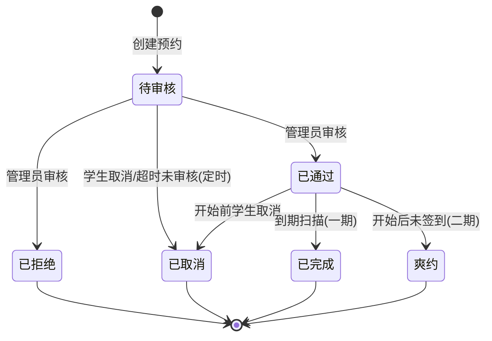

# 预约并发防超订：设计、改造与验证记录

> 对应代码：`app/services/reservation_service.py`、`app/models/reservation.py`、`migrations/versions/8f3a1c2d9e01_reservation_concurrency_guard.py`、`app/scheduler.py`
> 验证：`tests/test_reservation_concurrency.py`（pytest）、`scripts/loadtest_reserve.py`（Locust）
> 日期：2026-10-25

## 1. 问题背景

预约创建原为"先查再插"（check-then-insert）：先 SELECT 检查时段是否冲突，无冲突再 INSERT。两个并发请求可能同时读到"无冲突"然后都插入成功，造成**同一时段重复预约（超订）**。

早期版本曾对冲突检测结果集加 `SELECT ... FOR UPDATE`，但存在两个致命问题：

- **RR 隔离级别（MySQL 默认）**：抢一个"空时段"（无已存在行）时加的是**间隙锁**，而间隙锁彼此兼容 → 两个并发首单都能拿到间隙锁 → 双方 INSERT 互相等待对方 → **死锁 1213**，且无重试，用户直接看到 500。
- **RC 隔离级别**：间隙锁消失，但对空结果集**完全不锁** → 竞态原样回归。所以"改 RC 避死锁"不可行。

## 2. 方案对比结论

| 方案 | 结论 | 关键原因 |
| --- | --- | --- |
| 直接对现有表加唯一索引 | ❌ 不可行 | 唯一索引只能防"完全相同键"，防不了**区间重叠** |
| 时间槽位化 + 唯一索引 | ✅ 可行但未采用 | 强制 30 分钟粒度（改产品语义）、一单多行、改动面大 |
| **锁父行（labs 行 FOR UPDATE）** | ✅ **采用（主方案）** | 所有预约同一实验室的事务在父行上天然串行、锁顺序全局一致 → **结构性无死锁**；代价是单实验室吞吐 ≈ 1/事务耗时（约 100–200 TPS），业务量级远够用 |
| 生成列 + 唯一索引兜底 | ✅ 采用（兜底层） | 数据库最终防线，任何绕过应用锁的写入触发 1062 |
| Redis 分布式锁 | ❌ 不采用 | 单实例部署无收益；锁过期续期/误删/主从丢锁三坑；且**正确性最终仍需数据库约束兜底**，锁只是优化 |

## 3. 最终四层设计

```
L1 请求层    前端按钮 loading 防连点
L2 并发控制  SELECT ... FROM labs WHERE id=? FOR UPDATE（父行锁）
             └─ 开放时间/设备校验 → 区间重叠检测 → INSERT → COMMIT（同一事务）
L3 数据库兜底 uk_res_active_slot(lab_id, equip_key, date, start_time, end_time, active_marker)
L4 异常治理  1213/1205(死锁/锁超时) → 指数退避 50ms×2^n 重试 ≤3 次
             1062(唯一键冲突)     → 业务异常"手慢了，该时段刚被他人预约"
```

### 3.1 生成列技巧（MySQL 无部分索引的工程实现）

```sql
active_marker INT GENERATED ALWAYS AS (IF(status IN (0, 1), 1, NULL)) STORED
equip_key     INT GENERATED ALWAYS AS (IF(equipment_id IS NULL, 0, equipment_id)) STORED
UNIQUE KEY uk_res_active_slot (lab_id, equip_key, date, start_time, end_time, active_marker)
```

- `active_marker`：占用资源的集合 = 状态 {0 待审核, 1 已通过}。取消/完成/爽约后自动变 NULL，而 **MySQL 唯一索引允许多个 NULL** → 槽位自动释放，等价于 PostgreSQL 的部分索引。
- `equip_key`：实验室级预约的 `equipment_id` 为 NULL，而 **NULL 在唯一索引中永不冲突**（两条 equipment_id=NULL 的同时段记录本可同时插入）→ 哨兵列把 NULL 映射为 0 堵住该语义漏洞。

### 3.2 预约状态机

占用资源的集合 = `{0 待审核, 1 已通过}`；{2,3,4,5} 均为释放（active_marker→NULL）。



| 流转 | 合法性 | 说明 |
| --- | --- | --- |
| 0→1 / 0→2 | ✅ | 管理员审核 |
| 0→3 | ✅ | 学生取消；超时未审核由定时扫描置 3 |
| 1→3 | ✅ | 已通过也可取消（`cancel_reservation` 放开 `status in (0,1)`） |
| 1→4 | ✅ | 到期扫描自动完成 |
| 1→5 | 预留 | 签到功能二期再启用 |
| 1→2 | ❌ | 已通过不能"改判拒绝"，只能取消（审核结论不可追溯改写） |
| 终态→任何 | ❌ | 否则通知、统计、active_marker 全部失去语义 |
| 0→4/5 | ❌ | 未过审的预约不存在履约概念，过期一律 0→3 |

### 3.3 审核 / 取消的状态竞争

建约阶段的并发已经由父行锁解决，但**状态流转阶段**同样存在竞争，且更隐蔽：

| 场景 | 无锁时的后果 |
| --- | --- |
| 两个管理员同时点"通过"（或一个通过一个拒绝） | 双方都读到 `status=0`，后提交者覆盖先提交者；且**每人各发一条通知**，学生收到两条互相矛盾的审核结果 |
| 学生取消 与 管理员审核 并发 | 取消已提交（3），审核方仍按自己读到的旧快照写回 1 → 出现"已取消却通过"的脏数据 |
| 定时扫描（0→3）与 管理员审核 并发 | 扫描已把过期待审核置 3，审核方写回 1 → 把过期预约"复活"，且绕过 active_marker 释放语义 |

修复：`cancel_reservation` / `audit_reservation` 的 `SELECT` 都改为 `SELECT ... FOR UPDATE`，
把"读状态 → 判状态 → 写状态 + 写通知"收进同一个持锁事务。后到者拿到锁后会读到
最新已提交状态，直接走"当前状态不支持审核/取消"分支，不会覆盖也不会重复发通知。
回归测试 `tests/test_hardening.py::test_concurrent_audit_only_one_wins`
用两线程 Barrier 同时审核同一单，断言恰好 1 成功、1 被拒、通知只有 1 条。

## 4. 定时任务选型：APScheduler（不引入 Celery）

- 任务是"每分钟一条幂等批量 UPDATE"，无重试语义/无优先级/无削峰需求 → Celery 的 broker（Redis/RabbitMQ）纯属新增故障面。
- APScheduler：进程内零依赖；`coalesce + misfire_grace_time` 处理重启错过调度；`jitter=10` 打散整分钟尖峰；`max_instances=1` 防重入；启动立即执行一次（`next_run_time=now`）。
- **多 worker/多实例防重复执行**：任务内 `SELECT GET_LOCK('lab_expire_scan', 0)` MySQL 广播锁，拿不到锁本轮直接放弃（扫描幂等，双保险）。
- 什么时候换 Celery：任务变成"每单到点必达的延迟任务"且量大，或已有 Celery 集群——迁移理由是任务语义变化，不是锁。

## 5. 代码改动清单（函数级）

| 文件 | 改动 |
| --- | --- |
| `app/models/reservation.py` | 新增 `active_marker`/`equip_key` 生成列（`Computed(..., persisted=True)`）、`uk_res_active_slot` 唯一约束、`ix_res_lab_date` 索引、status 注释补 4/5 |
| `app/services/reservation_service.py` | `create_reservation` 重构为"参数校验 + 重试循环"；新增 `_create_reservation_once`（父行锁→校验→检测→插入→提交单事务）、`_db_errno`（提取 pymysql 错误码）；`cancel_reservation` 放开 1→3；`cancel_reservation`/`audit_reservation` 加 `SELECT ... FOR UPDATE` 行锁（见 §3.3）；`expire_pending_reservations` 拆双规则（0 且过期→3，1 且过期→4）+ GET_LOCK + 批量 UPDATE 替代逐行循环；删除旧 `run_expire_scan` |
| `app/scheduler.py`（新增） | AsyncIOScheduler 封装：60s 间隔/jitter/coalesce/misfire_grace_time/max_instances=1 |
| `app/main.py` | lifespan 改为调度器先行、知识库预热放后台任务；**修复 lifespan 未接线存量 bug**（见 §6） |
| `migrations/`（新增） | env.py 接入 settings + 模型元数据；版本 `8f3a1c2d9e01`：先去重（活跃同时段保留 MIN(id)，其余置 3）→ 加两生成列 → 建唯一键与索引；`downgrade` 可完整回滚 |
| `app/api/notification.py` 等 | 无改动；前端 `MyReservation.vue`/`AuditReservation.vue` 状态字典与筛选项补 4 已完成/5 爽约 |
| `requirements.txt` | 增 `alembic`、`APScheduler`，测试依赖 `pytest`、`locust` |

API 签名零变化；行为变化：已通过可取消；极端竞态重复提交提示"手慢了…"；到期记录自动出现状态 4。

## 6. 顺带修复的存量缺陷（重要记录）

1. **lifespan 从未接线**：`app = FastAPI()` 一直没传 `lifespan=lifespan` → 知识库预热和旧版过期扫描任务**在项目历史上从未运行过**（数据库积压过期 0/1 状态记录即证据）。修复为 `FastAPI(lifespan=lifespan)`。
   - 定位手段：插入"昨天的待审核"金丝雀记录 → 75 秒无状态变化 → 排除调度器本身（单进程直调正常）→ 锁定 uvicorn 进程内 lifespan 未执行。
2. **预热阻塞启动**：接线后发现 embedding 模型加载的 HuggingFace 网络检查（国内环境超时重试）会把启动卡 2 分钟+。改为 `asyncio.create_task` 后台预热，服务秒级可用（`kb_service.search` 本身有懒加载兜底）。

## 7. 验证记录

### 7.1 pytest（`tests/`，独立测试库 lzjai_test，5/5 通过）

| 用例 | 断言 |
| --- | --- |
| `test_concurrent_same_slot_exactly_one_winner` | 20 线程 Barrier 对齐抢同一空档：恰好 1 成功 / 19 冲突 / 0 异常；库中活跃记录=1 且 marker=1 |
| `test_concurrent_different_labs_no_interference` | 并发预约不同实验室互不阻塞 |
| `test_unique_index_rejects_duplicate_active_row` | 绕过应用锁直插重复活跃记录 → IntegrityError 1062（含 equip_key NULL 语义验证） |
| `test_unique_index_releases_slot_after_cancel` | 取消后 marker→NULL，同时段可再插入 |
| `test_state_machine_create_audit_cancel_rebook` | 0→3、0→1→3、终态拒绝、取消后重约 |

### 7.2 Locust 压测（50 并发 / 60s / 10,040 请求 ≈ 167 RPS，Windows 开发机单 worker）

| 指标 | 随机时段(70%流量) | 热门时段(30%流量，高争抢) |
| --- | --- | --- |
| 请求数 | 6,969 | 3,021 |
| P50 / P95 / P99 | 110 / 270 / 320 ms | 210 / 310 / 360 ms |

| 全局指标 | 数值 |
| --- | --- |
| 预约成功 / 业务冲突 / 错误 | 1,425 / 8,565(85.7%) / **0** |
| 超订 | **0** |
| 死锁重试（日志 grep "预约写入遇到锁冲突"） | **0 次** |
| 唯一索引兜底触发（1062） | 0 次（父行锁已完全串行化，兜底从未出手） |
| InnoDB | 行锁等待 26,347 次（父行排队，符合设计），平均 89ms / 最大 608ms / 当前 0；`LATEST DETECTED DEADLOCK` 无记录 |

> 热门时段冲突率≈100% 且全部为业务提示（非 5xx）——正是"争抢路径全走锁排队 + 冲突检测"的预期形态。

## 8. 复现命令

```bash
cd backend

# 单元/并发测试
python -m pytest tests/ -v

# 压测（另开终端先起服务）
uvicorn app.main:app --port 8000
python -m locust -f scripts/loadtest_reserve.py --headless \
    -u 50 -r 10 -t 60s --host http://127.0.0.1:8000 --csv report

# 死锁指标
grep -c "预约写入遇到锁冲突" <服务日志>          # 死锁/锁超时重试次数（预期 0）
grep -c "唯一索引兜底命中"     <服务日志>          # 1062 兜底触发次数

# MySQL 侧
SHOW GLOBAL STATUS LIKE 'Innodb_row_lock%';       -- 行锁等待统计
SHOW ENGINE INNODB STATUS;                        -- LATEST DETECTED DEADLOCK 应为无

# 压测数据清理（remark 前缀约定）
DELETE FROM reservations WHERE remark LIKE 'loadtest%';

# 迁移管理
alembic upgrade head                              # 升级
alembic downgrade -1                              # 回滚上一版
```

## 9. 简历/面试要点

**一句话版**：

> 设计并实现预约系统并发防超订方案：MySQL 父行悲观锁消除 RR 隔离下间隙锁死锁，STORED 生成列+唯一索引实现"仅活跃预约唯一"的部分索引语义，叠加死锁退避重试；Locust 50 并发 1 万次请求 0 超订、0 死锁、0 5xx，热门冲突路径 P95 310ms。

**面试三层追问锚点**：

1. 为什么锁父行而不是结果集 → RR 下空时段只能加间隙锁、间隙锁兼容导致并发首单 INSERT 互等死锁的机制；锁父行使锁顺序全局一致，死锁从概率问题变为结构不可能。
2. 唯一索引里为什么有生成列 → MySQL 无部分索引；`IF(status IN(0,1),1,NULL)` + 多 NULL 不冲突实现"取消即释放"；`equip_key` 哨兵列修复 NULL 永不冲突的语义漏洞。
3. 怎么证明没有超订 → pytest 20 线程 Barrier 断言恰好 1 成功 + Locust 1 万次请求错误 0/死锁 0/兜底 0 次触发，且 InnoDB 无死锁记录。
